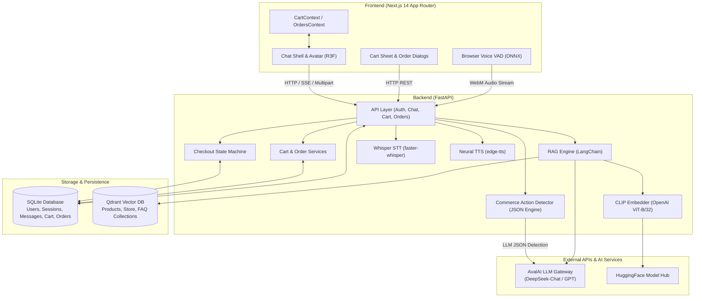
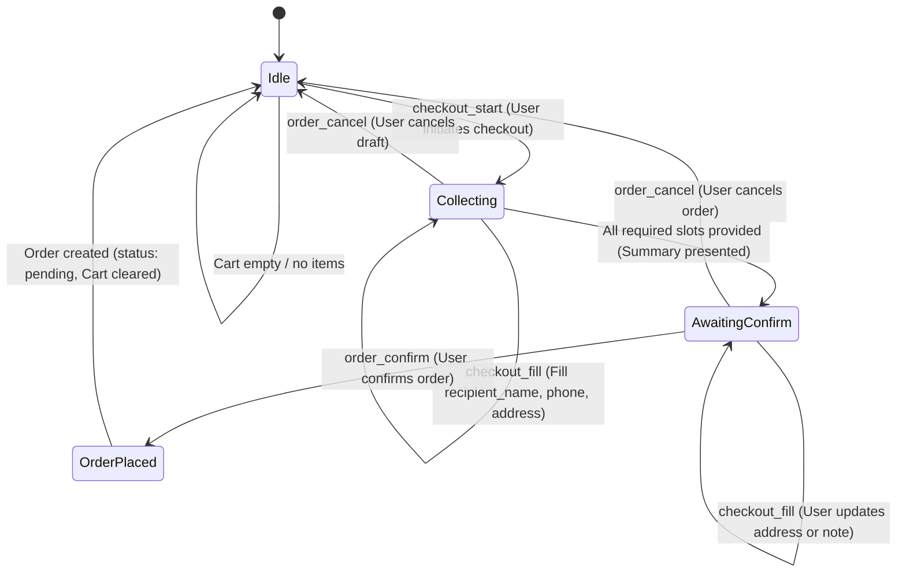

# 🛍️ PARAK — Intelligent Multimodal RAG & Conversational E-Commerce Assistant

**PARAK** (پَرَک) is a production-ready, full-stack **Conversational Commerce & Retrieval-Augmented Generation (RAG)** platform designed for modern e-commerce. It empowers users to explore products through text, images, or voice, receive personalized recommendations, manage their shopping cart, and complete full multi-turn checkouts directly within the conversation.

---

## 📸 Screenshots

### 👋 Welcome & Quick Actions


### 🎁 Product Recommendations & Details


### 📷 Visual / Image Search


### 🏪 Store Info & FAQ (Multilingual)


---

## ✨ Key Highlights

| Feature | Description |
|---------|-------------|
| 🛒 **Conversational Commerce** | Add, remove, view, and update cart items naturally via text or voice in Persian and English. |
| 💳 **In-Chat Checkout State Machine** | Guided multi-turn checkout collecting recipient name, phone, address, and notes with order confirmation. |
| 🛍️ **Cart & Order Management** | Dedicated Cart Sheet, live header badges, order tracking, and historical order details drawer. |
| 🔍 **Multimodal RAG** | Text and image-based product discovery using 512-dim CLIP embeddings indexed in Qdrant vector database. |
| 🧠 **Intelligent Intent & Action Routing** | Dual routing: LLM intent classifier (`products`, `store`, `faq`, `general`) + zero-temperature JSON action detector. |
| 🎙️ **Full-Duplex Voice Chat** | Client-side Voice Activity Detection (VAD) via ONNX → Whisper STT → Commerce RAG → Edge-TTS audio reply. |
| 🤖 **3D AI Avatar** | Interactive React Three Fiber avatar reacting dynamically with contextual facial emotions. |
| 📦 **Deep Product Inspection** | Resizable product sidebar with SKU variant selector (colors, sizes, pricing), image previews, and real-time stock info. |
| 💬 **Session & History Search** | Persistent sessions with pin, rename, full-text history search, and message-level citations. |
| 🔐 **Auth & User Profiles** | JWT authentication, bcrypt password hashing, email verification, and profile avatar uploads. |
| ⚡ **Modern Clinick Chat Shell** | Accessible Radix UI + shadcn/ui design, dark/light themes, and responsive mobile-first drawer navigation. |
| ⚙️ **Admin Ingestion Suite** | Background embedding engine for AliExpress-style product feeds, branch metadata, and FAQ documents. |

---

## 🏗️ Architecture



### 🔄 End-to-End Request Pipeline

1. **User Query Input**: The user sends a text query, an image attachment, or a recorded voice clip.
2. **Audio Transcription (Voice)**: Voice clips are converted via FFmpeg and transcribed by `faster-whisper`.
3. **Commerce Action Detection**:
   - The query is analyzed by a zero-temperature LLM prompt returning structured JSON actions:
     `cart_add` | `cart_view` | `cart_update` | `order_history` | `checkout_start` | `checkout_fill` | `order_confirm` | `order_cancel` | `clarify_product` | `none`.
   - **Product Pool Resolution**: Products are resolved from explicitly selected cards, the open product sidebar, or recent conversation turns.
4. **State Machine Execution**:
   - If a checkout is active, slots (`recipient_name`, `phone`, `address`, `note`) are extracted and merged into `chat_sessions.checkout_state`.
   - `order_confirm` validates cart pricing, creates a `pending` Order record, and empties the cart.
5. **RAG Fallback & Knowledge Retrieval**:
   - If the intent is not an in-progress checkout, intent classification categorizes the query into `product_search`, `store_info`, or `faq`.
   - Vector search queries Qdrant with CLIP embeddings (text or image) using cosine similarity.
6. **Response Generation**:
   - Synthesizes the response with LangChain and AvalAI.
   - Emits structured payload containing: assistant markdown message, matching product cards, avatar emotion, `cart_updated` boolean, `order` details, and `checkout_phase`.

---

## 🔄 In-Chat Checkout State Machine

The checkout flow is managed through a state machine stored in `chat_sessions.checkout_state`:



- **Required Slots**: `recipient_name` → `phone` → `address` (optional: `note`).
- **Confirmation Gate**: Orders are created **only** when the phase is strictly `awaiting_confirm` and the cart is valid.
- **Safety**: Unpriced items, zero-item carts, or ambiguous additions prompt clear conversational explanations.

---

## 🗄️ Qdrant Collections & Vector Schemas

| Collection | Purpose | Vector Dim | Distance | Payload Fields |
|------------|---------|------------|----------|----------------|
| `products` | Product catalog (multimodal text & image vectors) | 512 | Cosine | `product_id`, `subject`, `price`, `image_url`, `category_name`, `variants` |
| `store` | Physical store locations, operating hours, policies | 512 | Cosine | `branch_name`, `address`, `phone`, `hours`, `content` |
| `faq` | Customer service frequently asked questions | 512 | Cosine | `question`, `answer`, `category` |

---

## 🛠️ Tech Stack

### ⚙️ Backend
- **Framework**: FastAPI (asynchronous endpoints, streaming SSE, multipart form handling)
- **Database & ORM**: SQLAlchemy 2.0 with SQLite (WAL mode, auto-schema migration on startup)
- **Vector Search**: Qdrant (`qdrant-client`) with distance filtering and score thresholds
- **Vision-Language Embeddings**: OpenAI CLIP (`openai/clip-vit-base-patch32`) via HuggingFace Transformers
- **LLM Gateway**: AvalAI (`https://api.avalai.ir/v1`) with LangChain OpenAI integration (default model: `deepseek-chat`)
- **Speech-to-Text**: `faster-whisper` (`small` model, CPU int8 or CUDA fp16)
- **Text-to-Speech**: `edge-tts` (Persian `fa-IR-DilaraNeural`, English `en-US-JennyNeural`, Turkish `tr-TR-EmelNeural`)
- **Testing**: `pytest` with FastAPI TestClient

### 🎨 Frontend
- **Framework**: Next.js 14 (App Router) + TypeScript
- **Styling & Components**: Tailwind CSS, Radix UI Primitives, shadcn/ui, Lucide Icons
- **3D Graphics**: Three.js, React Three Fiber (`@react-three/fiber`), `@react-three/drei`
- **Voice Detection**: `@ricky0123/vad-web` with client-side ONNX Runtime Web
- **State Management**: React Context (`CartContext`, `OrdersContext`, `ThemeContext`)
- **Feedback & Notifications**: Sonner toasts

---

## 📁 Project Structure

```
.
├── backend/
│   ├── app/
│   │   ├── api/
│   │   │   ├── auth.py             # User registration, login, profile, avatars
│   │   │   ├── cart.py             # Cart CRUD endpoints (/api/cart)
│   │   │   ├── chat.py             # Chat streaming, session messages, commerce routing
│   │   │   ├── ingest.py           # Product catalog, store, and FAQ embedding pipelines
│   │   │   ├── orders.py           # Order creation & history endpoints (/api/orders)
│   │   │   ├── search.py           # Standalone multimodal search API
│   │   │   └── settings.py         # System configuration & threshold inspection
│   │   ├── core/
│   │   │   ├── database.py         # Engine, sessionmaker, and Base
│   │   │   └── security.py         # Password hashing & JWT token management
│   │   ├── ingestion/
│   │   │   ├── clip_embedder.py    # Singleton CLIP model loader (torch/transformers)
│   │   │   ├── json_loader.py      # AliExpress JSON parser & data sanitization
│   │   │   └── qdrant_store.py     # Qdrant collection lifecycle & point upsertion
│   │   ├── models/                 # SQLAlchemy ORM models (User, Session, Message, Cart, Order)
│   │   ├── schemas/                # Pydantic v2 validation models
│   │   ├── services/
│   │   │   ├── checkout_state.py   # State machine for conversational multi-turn checkout
│   │   │   ├── commerce.py         # Shared business logic for cart and order operations
│   │   │   ├── commerce_actions.py # NLP commerce intent extraction & product resolution
│   │   │   ├── rag.py              # Knowledge retrieval, prompt construction & LLM calling
│   │   │   ├── stt.py              # Whisper speech-to-text handler & audio conversion
│   │   │   └── tts.py              # Edge-TTS speech generation
│   │   ├── config.py               # Global settings from environment variables
│   │   ├── main.py                 # FastAPI application instance, lifespan & CORS
│   │   └── proxy_env.py            # Proxy sanitizer for resilient network connections
│   ├── tests/                      # Comprehensive pytest test suite
│   ├── requirements.txt            # Python dependencies
│   └── .env                        # Backend environment configuration
│
├── frontend/
│   ├── app/
│   │   ├── (dashboard)/
│   │   │   ├── chat/               # Main conversational workspace & sessions
│   │   │   ├── profile/            # User profile, password, and avatar management
│   │   │   └── settings/           # Admin ingestion management and threshold inspection
│   │   ├── auth/                   # Login, register, and verification pages
│   │   └── layout.tsx              # Root HTML layout and providers
│   ├── components/
│   │   ├── avatar/                 # 3D interactive AI avatar (Canvas, GLTF loader)
│   │   ├── cart/                   # CartSheet drawer & CartHeaderButton badge
│   │   ├── chat/                   # ChatPanel, MessageInput, ProductSidebar, SessionSidebar
│   │   ├── orders/                 # OrdersSheet drawer & OrdersHeaderButton
│   │   └── ui/                     # Accessible shadcn/ui components
│   ├── contexts/                   # CartContext & OrdersContext
│   ├── lib/                        # API client, commerceChat parser, and auth helpers
│   └── public/images/              # Project screenshots and branding
│
└── data/
    ├── AE_Data/                    # Sample product catalog JSON files
    ├── store.json                  # Physical store branches & policies
    └── faq.json                    # Customer support FAQs
```

---

## 📋 Prerequisites

| Requirement | Notes |
|-------------|-------|
| **Python** 3.10+ | Backend runtime |
| **Node.js** 18+ & npm | Frontend runtime |
| **Qdrant** | Vector database engine ([Install Qdrant](https://qdrant.tech/documentation/quick-start/)) |
| **FFmpeg** | Required for voice chat audio conversion |
| **CUDA GPU** (Optional) | Accelerates CLIP embedding and Whisper transcription (CPU supported via `int8`) |
| **AvalAI API key** | OpenAI-compatible LLM endpoint ([api.avalai.ir](https://api.avalai.ir)) |

---

## 🚀 Getting Started

### 1️⃣ Clone & Navigate

```bash
git clone <your-repo-url>
cd "RAG (new )"
```

### 2️⃣ Run Qdrant Vector Database

```bash
# Using Docker (Recommended)
docker run -d --name qdrant -p 6333:6333 -p 6334:6334 \
  -v $(pwd)/qdrant_storage:/qdrant/storage:z \
  qdrant/qdrant
```

Qdrant Web Console: [http://localhost:6333/dashboard](http://localhost:6333/dashboard)

### 3️⃣ Backend Setup

```bash
cd backend
python -m venv .venv
source .venv/bin/activate        # On Windows: .venv\Scripts\activate

# If using NVIDIA GPU (CUDA 12.x), install PyTorch first:
# pip install torch torchvision torchaudio --index-url https://download.pytorch.org/whl/cu128

pip install -r requirements.txt
```

Create `backend/.env`:

```env
# Database
DATABASE_URL=sqlite:///./app.db

# Security — Generate with: openssl rand -hex 32
SECRET_KEY=your-secret-key-here

# AvalAI (OpenAI-compatible) — https://api.avalai.ir/v1
AVALAI_API_KEY=aa-your-avalai-api-key
AVALAI_BASE_URL=https://api.avalai.ir/v1
AVALAI_MODEL=deepseek-chat

# Qdrant Vector Database
QDRANT_URL=http://localhost:6333
QDRANT_COLLECTION=products
QDRANT_COLLECTION_STORE=store
QDRANT_COLLECTION_FAQ=faq
VECTOR_SIZE=512

# RAG & Retrieval Tuning
RAG_TOP_K=10
RAG_SCORE_THRESHOLD=0.5
MIN_SCORE_TO_DISPLAY=0.35

# Data Paths
DATA_JSON_DIR=../data/AE_Data

# Voice Settings
WHISPER_MODEL_SIZE=small
TTS_VOICE_FA=fa-IR-DilaraNeural
TTS_VOICE_EN=en-US-JennyNeural

# Proxy (Optional — if behind a proxy or VPN)
# IMAGE_FETCH_PROXY=http://127.0.0.1:10808
```

Run the backend server:

```bash
uvicorn app.main:app --reload --host 0.0.0.0 --port 8000
```

Swagger API documentation will be available at [http://localhost:8000/docs](http://localhost:8000/docs).

### 4️⃣ Frontend Setup

```bash
cd ../frontend
npm install
npm run dev
```

Open the application at [http://localhost:3000](http://localhost:3000).

### 5️⃣ Ingest Catalog into Qdrant

1. Sign up or log in to the web interface.
2. Navigate to **Settings → Data Ingestion**.
3. Click **Ingest Products** (parses `data/AE_Data/` and embeds with CLIP).
4. Click **Ingest Store & FAQ** (indexes `data/store.json` and `data/faq.json`).

Or trigger programmatically via curl:

```bash
# Ingest Products
curl -X POST "http://localhost:8000/api/ingest?limit=200" \
  -H "Authorization: Bearer <your_jwt_token>"

# Ingest Store Info & FAQs
curl -X POST "http://localhost:8000/api/ingest/store-faq" \
  -H "Authorization: Bearer <your_jwt_token>"
```

---

## 📖 Conversational Commerce & Usage Guide

### 🛒 In-Chat Cart & Ordering
PARAK supports natural, fluid conversational shopping in both Persian and English:

- **Add to Cart**:
  - *"این محصول اولی رو اضافه کن به سبدم"* (Adds the first product from recent recommendations).
  - *"کت چرمی سایز L رنگ مشکی رو می‌خوام بخرم"* (Detects product, size, and color variant).
- **View & Edit Cart**:
  - *"سبد خریدم رو نشون بده"* (Displays current cart items and subtotal).
  - *"تعدادش رو بکن ۲ تا"* or *"محصول دومی رو حذف کن"*.
- **Initiate Checkout**:
  - *"می‌خوام سفارشم رو ثبت کنم"* → Assistant starts the slot-filling sequence:
    1. Recipient name (*نام تحویل‌گیرنده*)
    2. Phone number (*شماره تماس*)
    3. Delivery address (*آدرس تحویل*)
    4. Optional notes (*توضیحات سفارش*)
- **Review & Confirm**:
  - PARAK provides a structured order summary with items, subtotal, and shipping address.
  - User says *"تایید می‌کنم"* or *"ثبت نهایی کن"* → Order is saved as `pending`, cart is cleared, and an order receipt is returned.
  - User says *"انصراف"* or *"کنسل کن"* → Checkout is aborted and state returns to `idle`.

### 🛍️ Cart Sheet & Orders Drawer
- **Cart Sheet**: Click the cart icon in the header to view items, modify quantities, remove products, and review price subtotals in real-time.
- **Orders Drawer**: Click the orders icon to view past orders, track order statuses (`pending`, `completed`), and inspect line items.

### 🖼️ Visual / Multimodal Search
Upload any image (clothing, furniture, gadgets) by clicking the attachment icon. CLIP generates visual embeddings and Qdrant retrieves visually and stylistically similar items from the catalog.

### 🎙️ Full-Duplex Voice Chat
Click the microphone icon to initiate hands-free shopping. Speak naturally in Persian or English; local VAD detects speech boundaries, transcribes via Whisper, conducts RAG retrieval, and replies in high-fidelity neural speech.

---

## 🔌 API Reference

### 🔐 Authentication (`/api/auth`)
| Method | Endpoint | Description |
|--------|----------|-------------|
| `POST` | `/api/auth/register` | Register a new user account |
| `POST` | `/api/auth/login` | Authenticate and obtain JWT access token |
| `GET`  | `/api/auth/me` | Fetch currently authenticated user profile |
| `PATCH`| `/api/auth/profile` | Update profile information |
| `POST` | `/api/auth/avatar` | Upload user profile picture |

### 💬 Chat & Voice (`/api`)
| Method | Endpoint | Description |
|--------|----------|-------------|
| `POST` | `/api/chat` | Send conversational message (supports text, image, selected products, and sidebar product) |
| `POST` | `/api/voice-chat` | Send voice audio clip (handles STT, commerce detection, RAG, and returns audio reply) |
| `POST` | `/api/read-aloud` | Generate neural TTS speech for given text snippet |
| `GET`  | `/api/sessions` | List all chat sessions for current user |
| `GET`  | `/api/sessions/{id}/messages` | Retrieve conversation history for a session |
| `PATCH`| `/api/sessions/{id}` | Update session title or pinned state |
| `DELETE`| `/api/sessions/{id}` | Delete a chat session and its history |

### 🛒 Cart (`/api/cart`)
| Method | Endpoint | Description |
|--------|----------|-------------|
| `GET`  | `/api/cart` | Retrieve user cart with item count, line items, and checkout readiness |
| `POST` | `/api/cart/items` | Add product to cart (with quantity and variant label snapshot) |
| `PATCH`| `/api/cart/items/{item_id}` | Update quantity of a cart item |
| `DELETE`| `/api/cart/items/{item_id}`| Remove specific item from cart |

### 📦 Orders (`/api/orders`)
| Method | Endpoint | Description |
|--------|----------|-------------|
| `GET`  | `/api/orders` | List order history for current user (newest first) |
| `POST` | `/api/orders` | Create a new pending order from the current cart |

### ⚙️ Ingestion & Search (`/api`)
| Method | Endpoint | Description |
|--------|----------|-------------|
| `POST` | `/api/search` | Multimodal vector search for catalog products |
| `POST` | `/api/ingest` | Trigger background product embedding into Qdrant |
| `POST` | `/api/ingest/store-faq`| Embed store branch information and FAQ records |
| `GET`  | `/api/ingest/status` | Check live status of the ingestion pipeline |
| `POST` | `/api/ingest/stop` | Terminate active ingestion job |

---

## 🧪 Testing

The backend includes a comprehensive test suite covering commerce action detection, cart CRUD, checkout state machine transitions, and order creation:

```bash
cd backend
source .venv/bin/activate
pytest tests/ -v
```

Key test modules:
- `test_commerce_detector.py`: Validates zero-temperature action JSON detection across Persian and English phrasing.
- `test_checkout_state.py`: Verifies state machine transitions (`idle` → `collecting` → `awaiting_confirm` → `idle`).
- `test_commerce_execute.py`: Tests execution of cart and order actions against isolated SQLite sessions.
- `test_cart.py` & `test_orders.py`: Tests REST APIs for cart and order lifecycle.

---

## ⚙️ Configuration Reference

| Environment Variable | Default Value | Description |
|----------------------|---------------|-------------|
| `AVALAI_API_KEY` | `""` | AvalAI API key |
| `AVALAI_BASE_URL` | `https://api.avalai.ir/v1` | OpenAI-compatible endpoint URL |
| `AVALAI_MODEL` | `deepseek-chat` | Default LLM model identifier |
| `DATABASE_URL` | `sqlite:///./app.db` | SQLAlchemy database connection string |
| `SECRET_KEY` | *(Required)* | JWT signing key (generate with `openssl rand -hex 32`) |
| `QDRANT_URL` | `http://localhost:6333` | URL of the running Qdrant instance |
| `VECTOR_SIZE` | `512` | Embedding vector dimension (must match CLIP model) |
| `RAG_TOP_K` | `10` | Maximum vector matches retrieved per query |
| `RAG_SCORE_THRESHOLD` | `0.5` | Minimum cosine similarity score threshold |
| `MIN_SCORE_TO_DISPLAY`| `0.35` | Minimum score threshold to display product cards |
| `WHISPER_MODEL_SIZE` | `small` | Faster-Whisper model size (`tiny`, `base`, `small`, `medium`) |
| `TTS_VOICE_FA` | `fa-IR-DilaraNeural` | Default neural voice for Persian speech synthesis |
| `TTS_VOICE_EN` | `en-US-JennyNeural` | Default neural voice for English speech synthesis |
| `IMAGE_FETCH_PROXY` | `""` | Optional HTTP/HTTPS proxy for downloading product images |

---

## 📄 License

This project is licensed for educational and demonstration purposes. Product data models and samples are structured around standard e-commerce formats.

---

## 🙏 Acknowledgments

- [OpenAI CLIP](https://github.com/openai/CLIP) via HuggingFace Transformers
- [Qdrant](https://qdrant.tech/) Vector Search Engine
- [AvalAI](https://api.avalai.ir/) High-Performance LLM Platform
- [faster-whisper](https://github.com/SYSTRAN/faster-whisper) & [edge-tts](https://github.com/rany2/edge-tts)
- UI Primitives by [shadcn/ui](https://ui.shadcn.com/) and [Radix UI](https://www.radix-ui.com/)
